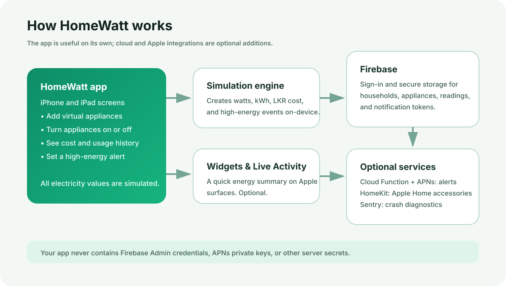

# HomeWatt

HomeWatt is an iPhone and iPad app for learning about household electricity use. It lets you add **virtual appliances**, turn them on or off, and see **simulated** power, energy, and cost estimates in Sri Lankan Rupees (LKR).

> Important: HomeWatt does not connect to a real electricity meter. Every energy value in the app is simulated. HomeKit accessories, if you choose to connect them, are shown separately and are not treated as a source of electricity readings.

## How HomeWatt fits together

You can use the app without knowing the technical details: HomeWatt calculates simulated readings on the device, saves your household data securely in Firebase when you are signed in, and can optionally show the same summary in a widget or a Live Activity.



| Part | In plain language | Needed for normal simulator use? |
| --- | --- | --- |
| HomeWatt app | The screens where you manage virtual appliances and view your energy estimate. | Yes |
| Simulation engine | Calculates simulated watts, kWh, costs, and high-energy events. | Yes |
| Firebase | Saves accounts, households, appliances, readings, and notification tokens. | Needed for account-based data |
| Widget and Live Activity | Shows a compact energy summary on the Home Screen, Lock Screen, or Dynamic Island. | Optional |
| Cloud Function and APNs | Sends a remote high-energy notification when configured by the project owner. | Optional |
| HomeKit and Sentry | Optional Apple Home controls and optional crash diagnostics. | Optional |

## What you can do

- Create an account and sign in with email and password.
- Create a household profile and set an electricity rate and high-energy threshold.
- Add virtual appliances such as fans, lights, refrigerators, and air conditioners.
- Turn appliances on or off and view simulated active power.
- View daily energy history, charts, peak demand, and estimated monthly LKR cost.
- Receive high-energy alerts when simulated power goes above your chosen threshold.
- Use Face ID or Touch ID as an optional local app lock.
- View HomeKit homes and compatible accessories separately from virtual appliances.
- Add HomeWatt Energy and HomeWatt Power Monitor widgets to the Home Screen.
- Start a Live Activity for simulated energy monitoring on supported iPhones.

## For everyday users

1. Open HomeWatt.
2. Choose **Sign Up** and create an account, or sign in if you already have one.
3. Complete the household setup.
4. Open **Devices** and add your appliances. These are virtual appliances for simulation.
5. Turn an appliance on to see its effect in **Dashboard**.
6. Open **History** to generate a day of simulated energy readings and view its chart.
7. Open **Settings** to change the electricity rate, energy-alert threshold, notification preference, biometric lock, or Live Activity.

## Open and run the app in Xcode

### What you need

- A Mac with Xcode installed. Xcode 26 or newer is recommended for this project.
- Internet access the first time, so Xcode can download Swift Package dependencies.
- An Apple ID in Xcode if you want to run on a physical iPhone or iPad.

### First run

1. Download or clone this repository.
2. Open [HomeWatt.xcodeproj](/Users/deshanlanka/Documents/HomeWatt/HomeWatt.xcodeproj) in Xcode.
3. Wait for package dependencies to finish resolving.
4. At the top of Xcode, choose the **HomeWatt** scheme.
5. Select an iPhone or iPad simulator.
6. Press the Run button (`⌘R`).
7. Create an account in the app and begin using the simulated appliance controls.

To test a widget, first run the **HomeWatt** app scheme. Then long-press the simulator or device Home Screen, choose **Edit → Add Widget**, and search for **HomeWatt**.

## Folder structure

```text
HomeWatt/
├── HomeWatt.xcodeproj/             Xcode project and build settings
├── HomeWatt/                       Main iOS/iPadOS application
│   ├── App/                        App entry point and navigation
│   ├── Models/                     Household, appliance, and energy data models
│   ├── Models/ViewModels/          Screen state and app business logic
│   ├── Services/
│   │   ├── Firebase/               Authentication, household, and appliance storage
│   │   ├── Simulation/             Simulated readings, cost, and energy detection
│   │   ├── Notifications/          Local alerts and Firebase Cloud Messaging support
│   │   ├── Security/               Face ID / Touch ID local app lock
│   │   ├── HomeKit/                Optional HomeKit discovery and controls
│   │   ├── LiveActivity/           Lock Screen and Dynamic Island support
│   │   ├── Widget/                 Data shared with Home Screen widgets
│   │   └── Diagnostics/            Optional Sentry diagnostics
│   ├── Views/                      SwiftUI screens
│   ├── Theme/                      HomeWatt colours and layout values
│   └── Resources/                  Firebase iOS configuration
├── HomeWattWidget/                 Widget extension and Live Activity UI
├── HomeWattTests/                  Focused automated tests
├── docs/                           Diagrams used by this README
│   └── architecture.svg            Visual overview of the app's data flow
├── functions/                      Firebase Cloud Function for remote energy alerts
├── firestore.rules                 Firestore security rules to deploy
└── README_CONFIGURATION.md         Apple and Firebase deployment checklist
```

## Configuration and `.env` files

### Does the iOS app use a `.env` file?

No. The iOS app does **not** read a `.env` file. Do not put passwords, Firebase Admin keys, APNs keys, or private API keys in the iOS app.

### Firebase iOS configuration

The app currently uses this file:

```text
HomeWatt/Resources/GoogleService-Info.plist
```

This is the Firebase client configuration for the iOS app. If you use your own Firebase project, download a new `GoogleService-Info.plist` from Firebase Console and replace this file. Its bundle identifier must be:

```text
com.deshanlanka.HomeWatt
```

### Sentry diagnostics

Sentry is optional. Its DSN is provided to the app through the Xcode build setting that generates the `SENTRY_DSN` Info.plist value. A Sentry DSN identifies the project that receives diagnostics; it is not an Admin secret.

To disable remote diagnostics, remove the `SENTRY_DSN` value from the **HomeWatt target → Build Settings** in Xcode. The app will continue to work.

### Firebase Cloud Functions

The current function in [functions/index.js](/Users/deshanlanka/Documents/HomeWatt/functions/index.js) does not require a `.env` file. It uses Firebase's managed server identity and Firebase Admin SDK after deployment.

If you later add local-only secrets for Functions development, put them in:

```text
functions/.env
```

Never commit that file. Use Firebase Secret Manager for deployed server-side secrets instead of sending secrets to the iOS app.

## Firebase setup for a project owner

These steps are required only if you want cloud sign-in, saved data, or remote notifications. The app can still be opened in the simulator without completing every optional service.

1. In Firebase Console, open the `homewatt-947e6` project or create your own Firebase project.
2. In **Authentication**, enable **Email/Password** sign-in.
3. In **Firestore Database**, create a database in Native mode.
4. Review and deploy [firestore.rules](/Users/deshanlanka/Documents/HomeWatt/firestore.rules).
5. For remote high-energy notifications, configure APNs in Apple Developer and upload the APNs key in Firebase Console → Project settings → Cloud Messaging.
6. Install the Firebase CLI, then deploy the Cloud Function from the repository root:

   ```bash
   npm install -g firebase-tools
   firebase login
   firebase use homewatt-947e6
   cd functions
   npm install
   cd ..
   firebase deploy --only functions
   ```

Cloud Functions deployment requires Firebase's Blaze plan. See [README_CONFIGURATION.md](/Users/deshanlanka/Documents/HomeWatt/README_CONFIGURATION.md) for the full configuration checklist.

## Apple capabilities for device testing

For physical-device testing, enable these capabilities for the app in Xcode and Apple Developer:

- Push Notifications
- Background Modes → Remote notifications
- HomeKit
- App Groups: `group.com.deshanlanka.HomeWatt`

The widget extension must use the same App Group. Regenerate provisioning profiles after changing Apple capabilities.

## Troubleshooting

| Problem | What to try |
| --- | --- |
| Xcode cannot download packages | Choose **File → Packages → Resolve Package Versions** and check your internet connection. |
| The app does not install in a simulator | Choose **Product → Clean Build Folder**, delete the old HomeWatt app from the simulator, then run again. |
| A widget shows old content | Open HomeWatt once, then remove and add the widget again. Widget refreshes are controlled by iOS and are not continuous. |
| Notifications do not arrive | Check iOS notification permission, the High Energy Alerts toggle, APNs/FCM configuration, and deployed Cloud Function. |
| Face ID is unavailable | Test on a device/simulator that has Face ID or Touch ID configured. |
| HomeKit is empty | Add a home or accessory in Apple's Home app first. HomeWatt will still work without HomeKit. |

## Privacy and security

- Household data is scoped to the signed-in Firebase user.
- Firestore rules validate the data written by the app.
- The app does not include Firebase Admin credentials or APNs private keys.
- Simulated energy data is clearly labelled as simulated.
- FCM device tokens are stored per signed-in user and removed during sign-out when possible.

## Development checks

The app, widget extension, and test target can be compiled with Xcode's **HomeWatt** scheme. Focused tests cover high-energy detection and widget metric calculations. Hardware-only features such as APNs, Face ID, HomeKit accessories, Live Activities, and actual widget hosting should also be tested on a physical device before release.
